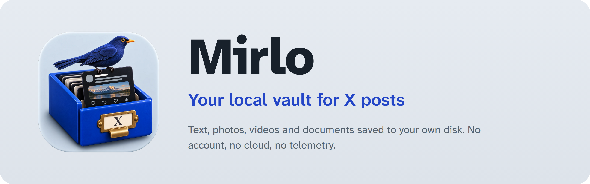

<p align="center">
  
</p>

<p align="center"><a href="README.md">Español</a> · <b>English</b></p>

A local vault for X (Twitter) posts. Paste a post link and Mirlo saves the text, author, date and every file to your own disk: photos at original resolution, videos, GIFs (as MP4) and linked documents (PDF, DOCX…).

No account, no cloud, no telemetry.

> The interface is available in English and Spanish. Mirlo follows your system language the first time; switch it anytime with the button next to the theme toggle.

## How to use it

1. Copy the link of a post on X.
2. Press <kbd>Ctrl</kbd>+<kbd>V</kbd> anywhere in the Mirlo window.
3. The post appears in the list. If something could not be downloaded, it is marked **◐ Partial** or **✕ Error**, and you can retry it with <kbd>R</kbd>.

| Shortcut | Action |
|---|---|
| <kbd>J</kbd> / <kbd>K</kbd> | Next and previous |
| <kbd>/</kbd> | Search (full text, accent-insensitive) |
| <kbd>Ctrl</kbd>+<kbd>V</kbd> | Save the copied link |
| <kbd>O</kbd> | Open the post's folder |
| <kbd>R</kbd> | Retry a partial or failed post |
| <kbd>F</kbd> | Mark or unmark as favorite |
| <kbd>T</kbd> / <kbd>M</kbd> / <kbd>N</kbd> | The post's tags, collection and note |

## Organizing

- **Favorites** (★) for what you want close at hand.
- **Collections**, like folders: each post goes in one or none. Create them with **+** in the sidebar, rename or delete them with a double click (or <kbd>F2</kbd>) and reorder them with <kbd>Alt</kbd>+<kbd>↑</kbd>/<kbd>↓</kbd>.
- **Tags**, as many as you like per post, with a palette color or any other from the color wheel.
- Personal **notes** on each post.

Notes and tags are searchable. Saving or retrying a post again never erases what you added: it lives in the database and in the `user` block of its `post.json`.

## Backups

Under **Backup** (top bar):

- **Export vault…** creates a `.zip` with everything. Untick *Include photos, videos and documents* for a light copy with text only.
- **Import backup…** brings it back, on this computer or another. **It merges and never overwrites:** posts you already have do not change, tags and favorites are added, and your notes and collections stay. Every file is checked against its SHA-256 fingerprint, and a backup with suspicious paths is rejected as a whole.

If the backup was light, imported posts are marked partial: <kbd>R</kbd> downloads what is missing.

## Where it is saved

```
~/Mirlo/
├── mirlo.db                          index for search and filters
└── <user>/<YYYY-MM-DD>_<id>/
    ├── post.json                     post, files with their SHA-256 and the original response
    ├── post.md                       the post as readable text
    ├── media/01.jpg, 02.mp4…         in the post's order (q01… = quoted post)
    └── attachments/                  linked documents
```

The folders are the real copy: you can copy them or read them without Mirlo.

## What leaves your computer

Mirlo only makes these requests, and only when you save or retry a post:

- **X** (`cdn.syndication.twimg.com`, `publish.x.com`, `pbs.twimg.com`, `video.twimg.com`): the post and its files.
- **yt-dlp** (bundled with the app): asks X for the post when the route above fails.
- **FxTwitter** (`api.fxtwitter.com`): **only** for posts longer than 280 characters, because X delivers them cut short. It receives the post's number.
- **Sites linked in the post**: Mirlo checks whether a link is a document (by its `Content-Type`) and, if it is and weighs less than 50 MB, downloads it. It never touches addresses on your local network.

The font ships inside the app: opening Mirlo contacts no one.

## Limitations

- It does not save full threads, or protected posts that require signing in.
- If FxTwitter does not respond, a long post stays partial (text cut short by X).

## Development

Requirements: Rust, Node 20+ and the system [dependencies for Tauri 2](https://tauri.app/start/prerequisites/).

```bash
npm install
npm run sidecar        # downloads yt-dlp for your platform and checks its SHA-256
npm run tauri dev
```

```bash
npm run check                                   # TypeScript and Svelte types
cd src-tauri && cargo test                      # tests against saved real responses
cd src-tauri && cargo test -- --ignored         # live tests against X
cd src-tauri && cargo clippy --all-targets -- -D warnings
npm run tauri build                             # .deb, .rpm and AppImage packages
```

The development notes in `docs/chronicler/` (decisions, errors and fixes, step by step) are in Spanish.

What comes next (Spanish): [`docs/ROADMAP.md`](docs/ROADMAP.md). Changes per version: [`CHANGELOG.md`](CHANGELOG.md).
