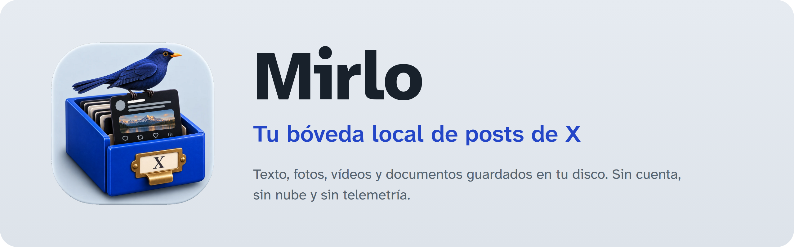

<p align="center">
  
</p>

<p align="center"><b>Español</b> · <a href="README-EN.md">English</a></p>

Bóveda local para posts de X (Twitter). Pegas el enlace de un post y Mirlo guarda en tu disco el texto, el autor, la fecha y todos sus archivos: fotos a resolución original, vídeos, GIF (como MP4) y documentos enlazados (PDF, DOCX…).

Sin cuenta, sin nube y sin telemetría.

> La interfaz está en español y en inglés. La primera vez Mirlo usa el idioma del sistema; puedes cambiarlo cuando quieras con el botón que hay junto al del tema.

## Cómo se usa

1. Copia el enlace de un post en X.
2. Pulsa <kbd>Ctrl</kbd>+<kbd>V</kbd> en cualquier parte de la ventana de Mirlo.
3. El post aparece en la lista. Si algo no se pudo bajar, se marca como **◐ Parcial** o **✕ Error** y puedes reintentarlo con <kbd>R</kbd>.

| Atajo | Acción |
|---|---|
| <kbd>J</kbd> / <kbd>K</kbd> | Siguiente y anterior |
| <kbd>/</kbd> | Buscar (texto completo, sin distinguir acentos) |
| <kbd>Ctrl</kbd>+<kbd>V</kbd> | Guardar el enlace copiado |
| <kbd>O</kbd> | Abrir la carpeta del post |
| <kbd>R</kbd> | Reintentar un post parcial o con error |
| <kbd>F</kbd> | Marcar o quitar favorito |
| <kbd>T</kbd> / <kbd>M</kbd> / <kbd>N</kbd> | Etiquetas, colección y nota del post |

## Organizar

- **Favoritos** (★) para lo que quieres tener a mano.
- **Colecciones**, como carpetas: cada post va en una o en ninguna. Se crean con **+** en la barra lateral, se renombran o borran con doble clic (o <kbd>F2</kbd>) y se reordenan con <kbd>Alt</kbd>+<kbd>↑</kbd>/<kbd>↓</kbd>.
- **Etiquetas**, todas las que quieras por post, con un color de la paleta o cualquier otro desde la rueda de color.
- **Notas** personales en cada post.

Las notas y las etiquetas entran en la búsqueda. Volver a guardar o reintentar un post nunca borra lo que añadiste: va en la BD y en el bloque `user` de su `post.json`.

## Copias de seguridad

En **Copia de seguridad** (barra superior):

- **Exportar bóveda…** crea un `.zip` con todo. Desmarca *Incluir fotos, vídeos y documentos* para una copia ligera con solo el texto.
- **Importar copia…** lo trae de vuelta, en este equipo o en otro. **Fusiona, nunca sobrescribe:** los posts que ya tienes no cambian, se suman etiquetas y favoritos, y tus notas y colecciones se quedan. Cada archivo se comprueba con su huella SHA-256, y una copia con rutas sospechosas se rechaza entera.

Si la copia era ligera, los posts importados quedan como parciales: <kbd>R</kbd> baja lo que falta.

## Dónde se guarda

```
~/Mirlo/
├── mirlo.db                          índice para buscar y filtrar
└── <usuario>/<YYYY-MM-DD>_<id>/
    ├── post.json                     post, archivos con su SHA-256 y la respuesta original
    ├── post.md                       el post en texto legible
    ├── media/01.jpg, 02.mp4…         en el orden del post (q01… = post citado)
    └── attachments/                  documentos enlazados
```

Las carpetas son la copia de verdad: puedes copiarlas o leerlas sin Mirlo.

## Qué sale de tu equipo

Mirlo solo hace estas peticiones, y solo cuando guardas o reintentas un post:

- **X** (`cdn.syndication.twimg.com`, `publish.x.com`, `pbs.twimg.com`, `video.twimg.com`): el post y sus archivos.
- **yt-dlp** (incluido en la app): pide el post a X cuando la vía anterior falla.
- **FxTwitter** (`api.fxtwitter.com`): **solo** para posts de más de 280 caracteres, porque X los entrega cortados. Recibe el número del post.
- **Los sitios enlazados en el post**: Mirlo mira si el enlace es un documento (por su `Content-Type`) y, si lo es y pesa menos de 50 MB, lo descarga. Nunca toca direcciones de tu red local.

La tipografía va dentro de la app: abrir Mirlo no llama a nadie.

## Limitaciones

- No guarda hilos completos ni posts protegidos o que requieren iniciar sesión.
- Si FxTwitter no responde, un post largo queda como parcial (texto cortado por X).

## Desarrollo

Requisitos: Rust, Node 20+ y las [dependencias de Tauri 2](https://tauri.app/start/prerequisites/) del sistema.

```bash
npm install
npm run sidecar        # descarga yt-dlp para tu plataforma y comprueba su SHA-256
npm run tauri dev
```

```bash
npm run check                                   # tipos de TypeScript y Svelte
cd src-tauri && cargo test                      # tests con respuestas reales guardadas
cd src-tauri && cargo test -- --ignored         # pruebas en vivo contra X
cd src-tauri && cargo clippy --all-targets -- -D warnings
npm run tauri build                             # paquetes .deb, .rpm y AppImage
```

La documentación del proceso está en `docs/chronicler/` (decisiones, errores y soluciones, paso a paso).

Qué viene después: [`docs/ROADMAP.md`](docs/ROADMAP.md). Cambios por versión: [`CHANGELOG.md`](CHANGELOG.md).

## Licencia

[GPL-3.0 o posterior](LICENSE). Puedes usar, estudiar, cambiar y compartir Mirlo; si distribuyes una versión modificada, su código tiene que ser también libre con esta misma licencia.
